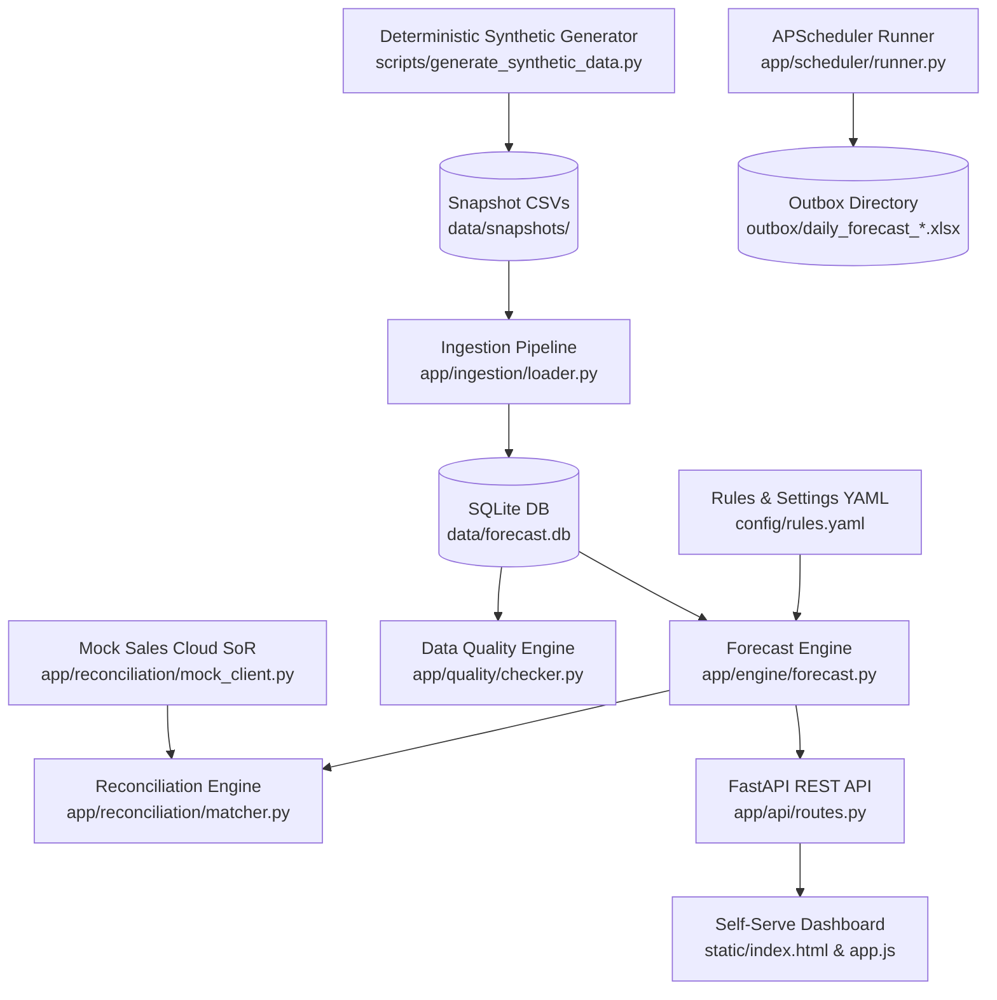

# Sales Forecast Automator

> Automated Sales Forecast Pipeline, Quality Checks & System of Record Reconciliation for the ATX Fall Co-Ops Bobathon.

ZIP FILE FOR SUBMISSION: 
.../sales-forecast-automator/dist/sales-forecast-automator-submission.zip


## 🎯 Executive Summary
The **Sales Forecast Automator** eliminates key-person risk, manual workbook refresh overhead, and silent pivot errors by delivering:
1. **Automated Daily Pipeline**: Ingests snapshot extracts, executes quality audits, reconciles totals against IBM Sales Cloud SoR, and generates legacy-compatible `.xlsx` files into `outbox/`.
2. **Self-Serve Web Dashboard**: Zero-build, accessible (WCAG 2.1 AA) single-page UI with real-time KPI tiles, interactive Chart.js drill-downs, and instant CSV/Excel export.
3. **Automated Data Quality Engine**: Catches duplicate orders, missing coverage IDs, non-positive ACVs, and day-over-day aggregate swings.
4. **3-Level Reconciliation against IBM Sales Cloud**: Level 1 (Grand Total), Level 2 (Date/Product Grain), and Level 3 (Order-level join) with planted variance classification and retry/backoff fault tolerance.
5. **Exact Legacy Parity**: Validated against an independent reference pivot implementation with mathematical equality to the cent.
6. **Strict Security & Synthetic Compliance**: Built on 100% synthetic data generated deterministically with zero real customer names, revenue figures, or hardcoded secrets.

---

## 🏗️ Architecture



---

## 🚀 Quick Start

### Option 1: Local Development
```bash
cd forecast-automator
python3 -m venv .venv
source .venv/bin/activate
pip install -r requirements.txt

# Run all unit, integration, parity & performance tests (with coverage)
PYTHONPATH=. pytest -v --cov=app --cov-report=term-missing

# Launch application server & background scheduler
uvicorn app.main:app --host 127.0.0.1 --port 8000
```
- **Web Dashboard**: [http://127.0.0.1:8000](http://127.0.0.1:8000)
- **OpenAPI Interactive Documentation**: [http://127.0.0.1:8000/docs](http://127.0.0.1:8000/docs)

### Option 2: Docker Compose
```bash
cd forecast-automator
docker compose up --build -d
```

### Synthetic data dates
Generated signing dates always fall in the 90 days ending on the as-of date (today by default), and snapshots are named `snapshot_<YYYY-MM-DD>.csv` for today and yesterday. Output is deterministic for a given seed and as-of date. Pin the date with `AS_OF_DATE`:
```bash
AS_OF_DATE=2026-10-26 python scripts/generate_synthetic_data.py --rows 2000 --seed 42
# -> data/snapshots/snapshot_2026-10-25.csv, data/snapshots/snapshot_2026-10-26.csv
```

---

## 📊 Verification & Test Results
All test suites run deterministically and provide comprehensive coverage across functional and non-functional requirements:

| Test Suite | Purpose | Status |
| :--- | :--- | :--- |
| [`test_generator.py`](tests/test_generator.py) | Determinism, synthetic data compliance, anomaly injection | ✅ PASS |
| [`test_reference_parity.py`](tests/test_reference_parity.py) | Exact mathematical parity with legacy pandas pivot | ✅ PASS |
| [`test_quality.py`](tests/test_quality.py) | 4-point data quality audit detection on planted flaws | ✅ PASS |
| [`test_reconciliation.py`](tests/test_reconciliation.py) | 3-level matching, tolerance, retry backoff, and dormancy | ✅ PASS |
| [`test_changes.py`](tests/test_changes.py) | Day-over-day added, removed, and modified deal detection | ✅ PASS |
| [`test_exporter.py`](tests/test_exporter.py) | Legacy openpyxl `.xlsx` column layout and number formatting | ✅ PASS |
| [`test_api.py`](tests/test_api.py) | FastAPI REST endpoints & OpenAPI schema validation | ✅ PASS |
| [`test_scheduler.py`](tests/test_scheduler.py) | Automated daily headless outbox generation | ✅ PASS |
| [`test_performance.py`](tests/test_performance.py) | Sub-2-second response on 50,000 synthetic rows (<0.15s actual) | ✅ PASS |

**Test Coverage**: **92%** on core application logic.

---

## 🔒 Security & Compliance
- **Synthetic Data**: Uses exclusively seeded synthetic records; zero real customer names, sales orders, or revenue data.
- **Red Hat UBI Minimal Container**: Hardened multi-stage container running as unprivileged non-root user (UID 1001).
- **Zero Secrets**: Configuration managed via environment variables and externalized YAML.
- **Local Assets**: Chart.js is bundled locally with zero runtime CDN calls.
