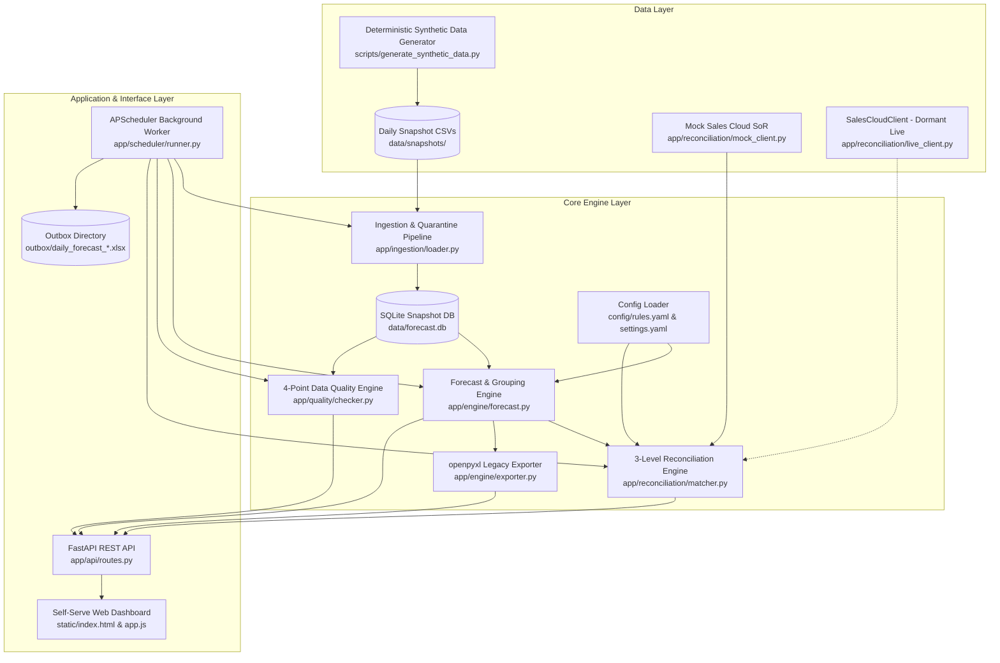

# Architecture & System Design Specification

## 1. Overview
The **Sales Forecast Automator** replaces a manual, point-in-time Excel spreadsheet workflow with an end-to-end automated data pipeline, self-serve interactive web dashboard, automated data quality auditor, and 3-level System of Record (SoR) reconciliation against IBM Sales Cloud.

## 2. Architecture Diagram

## 3. Component Details

### Ingestion & Quarantine (`app/ingestion/loader.py`)
- Reads daily snapshot CSV extracts.
- Loads records into SQLite `raw_deals` using a surrogate integer `id` to allow duplicate sales order IDs for data quality auditing.
- Identifies structurally invalid rows and inserts them into `quarantined_deals` with descriptive error logs.

### Forecast Engine (`app/engine/forecast.py`)
- Reads golden filtering rules dynamically from [`config/rules.yaml`](../config/rules.yaml).
- Computes KPI aggregations (Total ACV, Deal Count, Average Deal Size) and multidimensional grouping (by Day, Week, Month, Quarter, `ut_level_30_dscr`, Customer).
- Computes Day-over-Day delta comparisons against yesterday's snapshot.

### Data Quality Engine (`app/quality/checker.py`)
Executes 4 automated sanity audits:
1. **Duplicate Sales Orders**: Identifies redundant `sales_order_num` keys.
2. **Missing Coverage IDs**: Detects unassigned territory coverage records.
3. **Negative / Zero ACV**: Catches erroneous negative contract amounts.
4. **Day-over-Day Total Swing**: Flags unexpected aggregate portfolio shifts exceeding the configured threshold (default 25.0%).

### System of Record Reconciliation (`app/reconciliation/matcher.py`)
- Interfaces via `SalesSystemClient` abstraction.
- Performs 3-level cross-check:
  - **Level 1**: Grand Total USD Comparison.
  - **Level 2**: Date & UT30 Grain Comparison.
  - **Level 3**: Order-level join on `sales_order_num` classifying variances (`ONLY_IN_FORECAST`, `ONLY_IN_SALES_CLOUD`, `ACV_MISMATCH`, `ATTRIBUTE_MISMATCH`).
- Supports configurable per-order tolerance (0.01 USD) and transient network retry with exponential backoff.
- Labels report output with `FINAL`, `CHECK` (on mismatch), or `Not verified` (on service outage).

### Scheduler & Headless Delivery (`app/scheduler/runner.py`)
- Autonomous daily worker executing the entire pipeline.
- Exports openpyxl `.xlsx` matching legacy column layouts directly into [`outbox/`](../outbox/).
