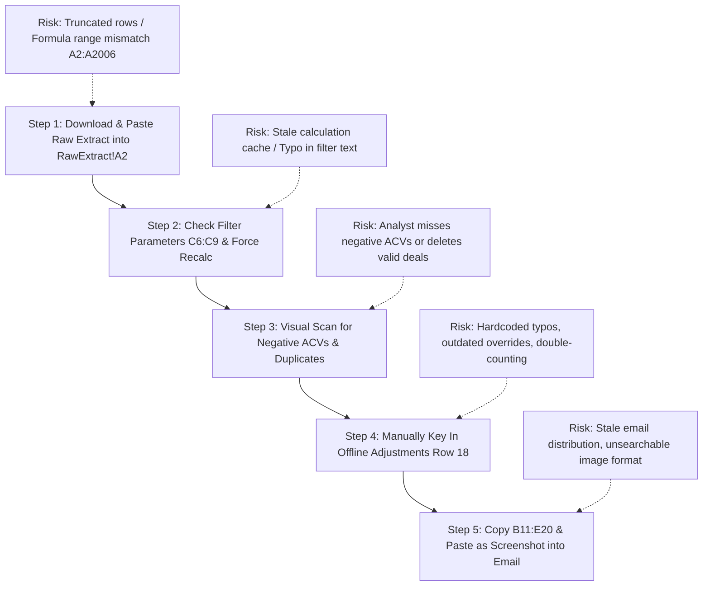

# Legacy Workbook Deep-Dive Analysis

**Subject**: Reverse-Engineering & Forensic Analysis of `Daily_Forecast_LEGACY.xlsx`  
**Author**: Systems & Data Operations Analyst  
**Target Audience**: Engineering Team, Sales Operations, and Leadership  

---

## 1. Inventory of Filters, Formulas, and Calculations

The workbook contains three sheets: `RawExtract`, `Pivot`, and `Notes`. The report logic is driven by a pseudo-pivot table constructed from live Excel multi-condition aggregation formulas referencing `RawExtract`.

### A. Filter Rule Parameters (Sheet: `Pivot`, Cells `B6:C9`)
The workbook isolates a specific segment of the sales pipeline using 4 parameter cells:

| Cell Reference | Parameter Label | Configured Value | Corresponding `RawExtract` Column |
| :--- | :--- | :--- | :--- |
| `Pivot!$C$6` | Country | `"United States"` | `RawExtract!H:H` (`country`) |
| `Pivot!$C$7` | Client Sub-Type | `"Select T Activate"` | `RawExtract!I:I` (`client_sub_type`) |
| `Pivot!$C$8` | Signing Category | `"New Signings"` | `RawExtract!J:J` (`signing_category`) |
| `Pivot!$C$9` | Product Area (UT15) | `"Data Platform"` | `RawExtract!B:B` (`ut_level_15_dscr`) |

---

### B. Summary Table Formulas by Product Row (Sheet: `Pivot`, Rows 12–17)
The report breaks down new signings across 6 distinct Product Offerings (`ut_level_30_dscr`):

| Row | Product Offering (`Column B`) | Deal Count Formula (`Column C`) | Total SaaS ACV USD Formula (`Column D`) | Average Deal Size Formula (`Column E`) |
| :---: | :--- | :--- | :--- | :--- |
| **12** | `Analytics Engine Serverless` | `=COUNTIFS(RawExtract!A$2:A$2006, B12, RawExtract!H$2:H$2006, $C$6, RawExtract!I$2:I$2006, $C$7, RawExtract!J$2:J$2006, $C$8, RawExtract!B$2:B$2006, $C$9, RawExtract!F$2:F$2006, "<>Acme Test Enterprise 999")` | `=SUMIFS(RawExtract!G$2:G$2006, RawExtract!A$2:A$2006, B12, RawExtract!H$2:H$2006, $C$6, RawExtract!I$2:I$2006, $C$7, RawExtract!J$2:J$2006, $C$8, RawExtract!B$2:B$2006, $C$9, RawExtract!F$2:F$2006, "<>Acme Test Enterprise 999")` | `=IF(C12>0, D12/C12, 0)` |
| **13** | `Data Product Hub Enterprise` | `=COUNTIFS(RawExtract!A$2:A$2006, B13, RawExtract!H$2:H$2006, $C$6, RawExtract!I$2:I$2006, $C$7, RawExtract!J$2:J$2006, $C$8, RawExtract!B$2:B$2006, $C$9, RawExtract!F$2:F$2006, "<>Acme Test Enterprise 999")` | `=SUMIFS(RawExtract!G$2:G$2006, RawExtract!A$2:A$2006, B13, RawExtract!H$2:H$2006, $C$6, RawExtract!I$2:I$2006, $C$7, RawExtract!J$2:J$2006, $C$8, RawExtract!B$2:B$2006, $C$9, RawExtract!F$2:F$2006, "<>Acme Test Enterprise 999")` | `=IF(C13>0, D13/C13, 0)` |
| **14** | `DataStage Modernized` | `=COUNTIFS(RawExtract!A$2:A$2006, B14, RawExtract!H$2:H$2006, $C$6, RawExtract!I$2:I$2006, $C$7, RawExtract!J$2:J$2006, $C$8, RawExtract!B$2:B$2006, $C$9, RawExtract!F$2:F$2006, "<>Acme Test Enterprise 999")` | `=SUMIFS(RawExtract!G$2:G$2006, RawExtract!A$2:A$2006, B14, RawExtract!H$2:H$2006, $C$6, RawExtract!I$2:I$2006, $C$7, RawExtract!J$2:J$2006, $C$8, RawExtract!B$2:B$2006, $C$9, RawExtract!F$2:F$2006, "<>Acme Test Enterprise 999")` | `=IF(C14>0, D14/C14, 0)` |
| **15** | `Db2 Warehouse SaaS` | `=COUNTIFS(RawExtract!A$2:A$2006, B15, RawExtract!H$2:H$2006, $C$6, RawExtract!I$2:I$2006, $C$7, RawExtract!J$2:J$2006, $C$8, RawExtract!B$2:B$2006, $C$9, RawExtract!F$2:F$2006, "<>Acme Test Enterprise 999")` | `=SUMIFS(RawExtract!G$2:G$2006, RawExtract!A$2:A$2006, B15, RawExtract!H$2:H$2006, $C$6, RawExtract!I$2:I$2006, $C$7, RawExtract!J$2:J$2006, $C$8, RawExtract!B$2:B$2006, $C$9, RawExtract!F$2:F$2006, "<>Acme Test Enterprise 999")` | `=IF(C15>0, D15/C15, 0)` |
| **16** | `watsonx.data Core` | `=COUNTIFS(RawExtract!A$2:A$2006, B16, RawExtract!H$2:H$2006, $C$6, RawExtract!I$2:I$2006, $C$7, RawExtract!J$2:J$2006, $C$8, RawExtract!B$2:B$2006, $C$9, RawExtract!F$2:F$2006, "<>Acme Test Enterprise 999")` | `=SUMIFS(RawExtract!G$2:G$2006, RawExtract!A$2:A$2006, B16, RawExtract!H$2:H$2006, $C$6, RawExtract!I$2:I$2006, $C$7, RawExtract!J$2:J$2006, $C$8, RawExtract!B$2:B$2006, $C$9, RawExtract!F$2:F$2006, "<>Acme Test Enterprise 999")` | `=IF(C16>0, D16/C16, 0)` |
| **17** | `watsonx.governance Cloud` | `=COUNTIFS(RawExtract!A$2:A$2006, B17, RawExtract!H$2:H$2006, $C$6, RawExtract!I$2:I$2006, $C$7, RawExtract!J$2:J$2006, $C$8, RawExtract!B$2:B$2006, $C$9, RawExtract!F$2:F$2006, "<>Acme Test Enterprise 999")` | `=SUMIFS(RawExtract!G$2:G$2006, RawExtract!A$2:A$2006, B17, RawExtract!H$2:H$2006, $C$6, RawExtract!I$2:I$2006, $C$7, RawExtract!J$2:J$2006, $C$8, RawExtract!B$2:B$2006, $C$9, RawExtract!F$2:F$2006, "<>Acme Test Enterprise 999")` | `=IF(C17>0, D17/C17, 0)` |

---

### C. Total and Adjustment Rows (Sheet: `Pivot`, Rows 18–20)

| Row | Label (`Column B`) | Deal Count (`Column C`) | Total ACV USD (`Column D`) | Avg Deal Size (`Column E`) | Calculation Logic |
| :---: | :--- | :---: | :---: | :---: | :--- |
| **18** | `[Manual Adjustment] Q2 Executive Plan Catch-up (Off-book)` | `1` | `$150,000.00` | `$150,000.00` | **Hardcoded values** (no formula connection to `RawExtract`). |
| **19** | `Subtotal (Extract Only)` | `=SUM(C12:C17)` *(Evaluates: 354)* | `=SUM(D12:D17)` *(Evaluates: $84,255,455.61)* | `=IF(C19>0, D19/C19, 0)` *(Evaluates: $238,009.76)* | System-calculated sum of rows 12–17. |
| **20** | `Grand Total (Reported to Leadership)` | `=SUM(C12:C18)` *(Evaluates: 355)* | `=SUM(D12:D18)` *(Evaluates: $84,405,455.61)* | `=IF(C20>0, D20/C20, 0)` *(Evaluates: $237,761.85)* | Total reported in executive email, including manual adjustment. |

---

## 2. Daily Manual Steps & Human Error Vulnerability Analysis

According to the SOP documented in `Notes!B5:B18`, an analyst executes 5 manual steps every morning. Each step introduces distinct failure modes:

| Step | SOP Instruction | Where Human Error Occurs | Business Consequence |
| :--- | :--- | :--- | :--- |
| **1. Morning Extract Refresh** | Download CSV extract; paste into `RawExtract` starting at `A2`. | **Range Overflow**: If the new extract has >2005 rows (e.g. 2,500 rows), formulas referencing `A$2:A$2006` silently drop the bottom 494 rows. **Column Shift**: Pasting columns out of order causes formulas to search invalid columns. | Silent revenue undercounting; management makes decisions on partial data. |
| **2. Filter & Recalc** | Confirm filter values in `C6:C9`; hit `Ctrl+Alt+F9`. | **Typo in Filter Cell**: A trailing whitespace or typo (e.g. `"Data Platform "` or `"Select T  Activate"`) results in **$0 reported revenue**. **Stale Calculation**: If Excel calculation is set to Manual and recalc is skipped, yesterday's numbers are resent. | Incorrect $0 reports or outdated point-in-time figures distributed. |
| **3. Quality Review** | Visually scan for negative ACVs and duplicate order IDs; manually delete rows. | **Cognitive Overload / Missed Rows**: A human cannot reliably spot 5 duplicate IDs among 2,000 rows. **Unrecorded Deletions**: Row deletions happen directly on the sheet with zero audit trail. | Corrupted totals delivered; impossible to trace why rows were deleted. |
| **4. Management Adjustments** | Verify offline verbal adjustments with sales VP; key into row 18. | **Stale Overrides**: Verbal adjustments from last week remain in the template indefinitely. **Sign Error**: Entering positive adjustment instead of negative rebate. | Inaccurate executive projections; compliance and governance violation. |
| **5. Email Distribution** | Copy `Pivot!B11:E20`; paste as table/image into email. | **Wrong Selection / Recipient Error**: Analyst accidentally includes raw unvetted columns or misses distribution list members. | Static, un-drillable screenshot sent; sales leaders cannot self-serve. |

---

## 3. Hidden Rules and Quirks Discovered

Forensic examination of the formulas and Notes revealed two unwritten rules that were never documented in formal system requirements:

### Quirk #1: Hardcoded Customer Exclusion in Formulas
- **Discovery**: Every `COUNTIFS` and `SUMIFS` formula in rows 12–17 contains the extra criteria:
  `RawExtract!F$2:F$2006, "<>Acme Test Enterprise 999"`
- **Rationale**: An internal test/partner sandbox account was polluting the extract numbers. Rather than fixing the upstream extraction query or parameterizing the exclusion, the analyst hardcoded `"<>Acme Test Enterprise 999"` into every single formula.
- **Risk**: If another test account is created (e.g. `Acme Test Enterprise 998`), it will leak into reported revenue unless someone remembers to edit all 12 formulas by hand.

### Quirk #2: Off-Book Manual Adjustment Row (Row 18)
- **Discovery**: `Pivot!B18:E18` contains a flat `+$150,000.00` credit labeled `[Manual Adjustment] Q2 Executive Plan Catch-up (Off-book)`.
- **Rationale**: Sales leadership verbally requested a catch-up credit for an off-cycle strategic deal.
- **Risk**: This $150k has no corresponding sales order number, customer record, or timestamp. It inflates `Grand Total` (`$84,405,455.61`) over `Subtotal` (`$84,255,455.61`) without creating an audit trail or reconciling against IBM Sales Cloud.

---

## 4. Key Operational and Systemic Risks

1. **Key-Person Dependency (Bus Factor = 1)**:
   Only one analyst knows how to triage the extract, check the hidden formulas, and apply the adjustment row. If that person is unavailable, the daily forecast is halted.
2. **Zero Audit Trail & Version Amnesia**:
   When raw rows are deleted or values are overwritten in `RawExtract`, historical snapshot state is permanently destroyed. Day-over-day changes cannot be reconstructed.
3. **Silent Formula Range Truncation**:
   Formulas are fixed to `A$2:A$2006`. As transaction volume grows past 2,005 rows, newly signed deals are dropped silently with zero Excel warnings.
4. **Disconnection from System of Record (ISC)**:
   The legacy spreadsheet operates completely isolated from IBM Sales Cloud. Rogue, cancelled, or duplicate deals in the extract are never cross-checked against official booked orders.

---

## 5. Replacement Mapping: Legacy Step $\rightarrow$ New Automator Architecture

| Legacy Manual Step / Component | Legacy File Reference | New Automated Module | Automated Architecture Improvement |
| :--- | :--- | :--- | :--- |
| **Raw Extract Ingestion** | `RawExtract!A1:J2006` | [`app/ingestion/loader.py`](forecast-automator/app/ingestion/loader.py:21) | Automated CSV ingestion into SQLite `raw_deals` with surrogate PKs; timestamped historical snapshots preserved. |
| **Bad Row Triage & Quarantine** | Manual row deletion in `RawExtract` | [`app/ingestion/loader.py`](forecast-automator/app/ingestion/loader.py:58) & [`app/quality/checker.py`](forecast-automator/app/quality/checker.py:9) | Bad or unparseable rows automatically routed to `quarantined_deals` table with descriptive error reasons. |
| **Report Filtering Rules** | `Pivot!B6:C9` (Country, Sub-Type, Category, UT15) | [`config/rules.yaml`](forecast-automator/config/rules.yaml:2) & [`app/engine/forecast.py`](forecast-automator/app/engine/forecast.py:11) | Externalized YAML configuration; rules updated dynamically with zero code changes or Excel formula edits. |
| **Product Aggregate Calculation** | `Pivot!C12:E17` (`SUMIFS` / `COUNTIFS`) | [`app/engine/forecast.py`](forecast-automator/app/engine/forecast.py:46) | Vectorized pandas computation yielding exact mathematical parity to the cent without fixed range limits. |
| **Hidden Exclusion Rule** | `<>Acme Test Enterprise 999` in formulas | [`config/rules.yaml`](forecast-automator/config/rules.yaml:1) (Configurable exclusions) | Formalized rule in configuration rather than hidden strings inside Excel formula cells. |
| **Manual Management Adjustments** | `Pivot!B18:E18` (Hardcoded $150k) | [`app/reconciliation/matcher.py`](forecast-automator/app/reconciliation/matcher.py:126) & [`app/api/schemas.py`](forecast-automator/app/api/schemas.py:53) | Off-book discrepancies explicitly surfaced as reconciliation variances (`ACV_MISMATCH` / `ONLY_IN_FORECAST`). |
| **Quality Sanity Checks** | Manual visual inspection of sheet | [`app/quality/checker.py`](forecast-automator/app/quality/checker.py:9) | 4 automated algorithms flagging duplicate order IDs, missing coverage IDs, non-positive ACVs, and DoD swings (>25%). |
| **Sales Cloud Fact-Checking** | None (Mental/verbal check) | [`app/reconciliation/matcher.py`](forecast-automator/app/reconciliation/matcher.py:11) | 3-Level automated cross-check joining on `sales_order_num` against Sales Cloud SoR; tags reports `FINAL`, `CHECK`, or `Not verified`. |
| **Daily Report Generation** | Manual Excel Save & Copy/Paste | [`app/scheduler/runner.py`](forecast-automator/app/scheduler/runner.py:21) & [`app/engine/exporter.py`](forecast-automator/app/engine/exporter.py:9) | Autonomous 6:00 AM APScheduler worker outputting styled `.xlsx` directly to [`outbox/`](forecast-automator/outbox/). |
| **Self-Serve Access & Drill-Down** | Static email table screenshot | [`static/index.html`](forecast-automator/static/index.html:1) & [`static/app.js`](forecast-automator/static/app.js:1) | Responsive, accessible web dashboard ([`http://127.0.0.1:8000`](http://127.0.0.1:8000)) with live KPI cards, Chart.js timeline, and deal search/sort table. |

---

## 6. Open Questions & Ambiguities for Sales Leadership

1. **Governance on Manual Adjustments (Row 18)**:  
   *Should off-book management adjustments (+ $150k) be formally entered as adjustments in IBM Sales Cloud, or should our configuration support an explicit `adjustments.yaml` audit table?*
2. **Upstream Sandbox Account Tagging (Quirk #1)**:  
   *Can test sandbox accounts (e.g. `Acme Test Enterprise 999`) be flagged upstream with `client_sub_type: "Test/Internal"` in the data portal so they are filtered naturally without account name lists?*
3. **Handling of Mismatched Reports**:  
   *When reconciliation flags `MISMATCH`, should the daily outbox delivery hold execution (`block_on_mismatch: true`) or proceed with the warning label `_CHECK.xlsx`?*
